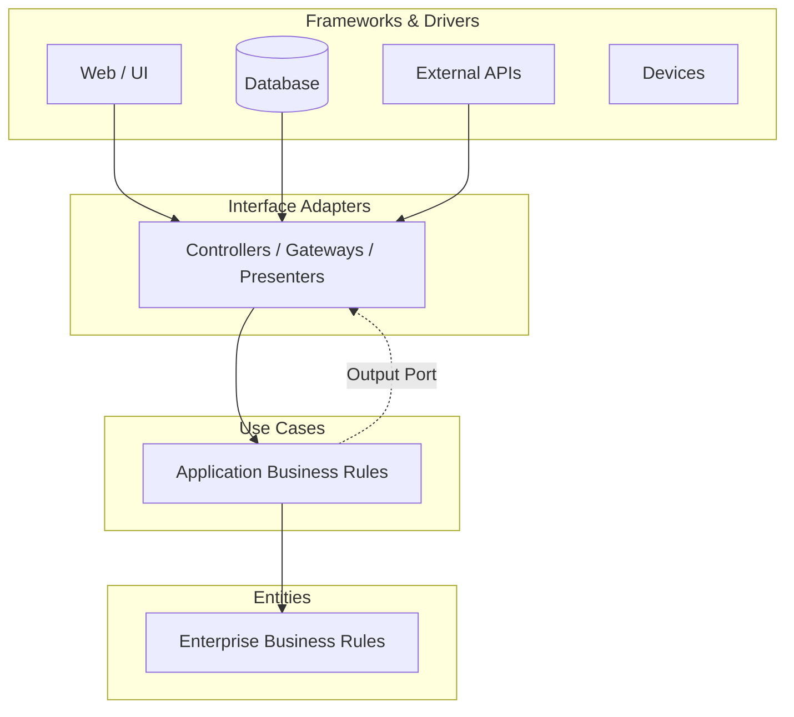
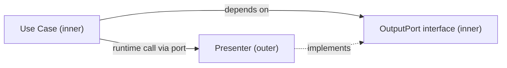
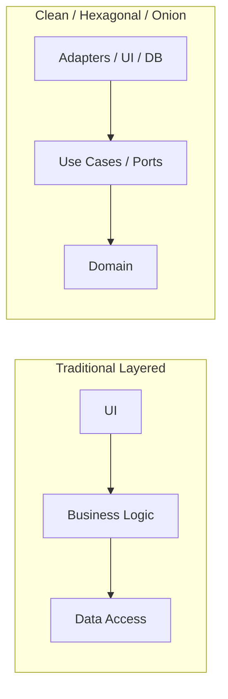

# Clean Architecture — Practical Reference & Implementation Guide

---

## 1. Overview

**Clean Architecture** was formulated by **Robert C. Martin (Uncle Bob)** in 2012 as a synthesis of several older architectural ideas — Hexagonal Architecture (Cockburn), Onion Architecture (Palermo), Screaming Architecture, DCI (Coplien/Reenskaug), and BCE (Jacobson).

The core premise: **business rules should be the most independent, most testable part of a system** — free from entanglement with frameworks, databases, UI, and external agencies.

### Purpose

Produce systems that are ([source: The Clean Code Blog](https://blog.cleancoder.com/uncle-bob/2012/08/13/the-clean-architecture.html)):

1. **Independent of Frameworks** — frameworks are tools, not the system's identity
2. **Testable** — business rules testable without UI, DB, web server, or any external element
3. **Independent of UI** — swap a web UI for a console UI without touching business rules
4. **Independent of Database** — swap Oracle → Mongo → Postgres with minimal fuss
5. **Independent of any external agency** — business rules "simply don't know anything at all about the outside world"

### Key Benefits at a Glance

| Benefit | Why It Matters |
|---|---|
| Long-term maintainability | Business logic changes are isolated from technical churn |
| High test coverage is cheap | Pure domain logic needs no mocks of frameworks/DB |
| Technology agility | Swap infrastructure (DB, web framework) without rewrites |
| Delayed decisions | Choose DB/framework late, when you know more |
| Parallel team work | Clear seams let teams work on separate layers |

### The Diagram



> Dependencies (source code dependencies) always point **inward**; the flow of control may go both ways — resolved via the Dependency Inversion Principle.

---

## 2. Core Principles

### 2.1 Separation of Concerns (SoC)

The system is divided into layers, each with a distinct responsibility: business rules vs. interfaces vs. mechanisms. The further inward you go, the **higher the level of abstraction** — "outer circles are mechanisms, inner circles are policies."

### 2.2 The Dependency Rule

> *"Source code dependencies can only point inwards. Nothing in an inner circle can know anything at all about something in an outer circle."* — Uncle Bob

Concretely:

- Inner layers must never mention names (classes, functions, variables) declared in outer layers
- Data crossing boundaries must be **simple, isolated data structures** (DTOs, plain args) — never DB rows, framework entities, or ORM models
- Formats generated by an outer framework must not leak inward

### 2.3 Dependency Inversion Principle (DIP)

> *"Abstractions should not depend upon details. Details should depend upon abstractions."*

This is the mechanism that makes the Dependency Rule possible when control flow goes outward. Example: a Use Case needs to call a Presenter — but a direct call would violate the rule. Instead, the Use Case calls an **interface (Output Port)** defined in the inner circle; the Presenter in the outer circle implements it. Dynamic polymorphism creates source dependencies that oppose the flow of control.



### 2.4 SOLID Principles

| Principle | Meaning | In Clean Architecture Terms |
|---|---|---|
| **S** — Single Responsibility | One reason to change per module | Each layer changes for its own reasons; entities unaffected by UI/DB changes |
| **O** — Open/Closed | Open for extension, closed for modification | New use cases extend; core entities untouched |
| **L** — Liskov Substitution | Subtypes substitutable for base types | Adapter implementations are interchangeable behind ports |
| **I** — Interface Segregation | Many specific interfaces > one fat interface | Narrow input/output ports per use case |
| **D** — Dependency Inversion | Depend on abstractions | The foundation of the entire architecture |

> Reference: [The Principles of OOD — Robert C. Martin](https://web.archive.org/web/20180822202505/http://www.butunclebob.com/ArticleS.UncleBob.PrinciplesOfOod); modern official summary: [AWS Prescriptive Guidance on SOLID](https://docs.aws.amazon.com/prescriptive-guidance/latest/modernization-choosing-services/solid-principles.html)

---

## 3. Architectural Layers

*(Descriptions from [the original article](https://blog.cleancoder.com/uncle-bob/2012/08/13/the-clean-architecture.html). Circles are schematic — you may need more or fewer than four, but the Dependency Rule always applies.)*

| Layer | Responsibility | Knows About | Changes When |
|---|---|---|---|
| **Entities** (innermost) | Enterprise-wide business rules; the most general, high-level rules | Nothing outward | Rarely — never due to UI, navigation, or security changes |
| **Use Cases** | Application-specific business rules; orchestrate data flow to/from entities to achieve use-case goals | Entities only | When the application's operation/requirements change |
| **Interface Adapters** | Convert data between the format convenient for use cases/entities and formats for DB, Web, external services; contains Controllers, Presenters, Views, Gateways | Use Cases, Entities | When UI or storage formats change; **all SQL lives here** |
| **Frameworks & Drivers** (outermost) | The details: web framework, DB, tools. Mostly glue code | Inward layers | Whenever technology changes — "the Web is a detail. The database is a detail." |

### Boundary Crossing Data

Data crossing boundaries should be **simple data structures**:

- Basic structs / DTOs / request–response models
- Or plain function arguments / hashmaps
- **Never** pass Entities or DB row structures inward

---

## 4. Project Structure

### Generic (framework-agnostic)

```
src/
├── domain/                      # Entities layer
│   ├── entities/
│   │   ├── order.ts
│   │   └── customer.ts
│   └── value-objects/
│       └── money.ts
├── application/                 # Use Cases layer
│   ├── use-cases/
│   │   └── place-order.ts
│   ├── ports/                   # Interfaces defined here (DIP)
│   │   ├── order-repository.ts  #   output ports
│   │   └── payment-gateway.ts
│   └── dto/
│       └── place-order-dto.ts
├── infrastructure/              # Frameworks & Drivers
│   ├── persistence/
│   │   └── postgres-order-repository.ts
│   ├── payment/
│   │   └── stripe-gateway.ts
│   └── config/
└── presentation/                # Interface Adapters
    ├── controllers/
    │   └── order-controller.ts
    ├── presenters/
    │   └── order-presenter.ts
    └── routes/
```

### Feature-oriented variant ("Screaming Architecture" — names scream the domain, not the framework)

```
src/
├── modules/
│   ├── orders/
│   │   ├── domain/
│   │   ├── application/
│   │   ├── infrastructure/
│   │   └── presentation/
│   └── customers/
│       ├── domain/
│       ├── application/
│       ├── infrastructure/
│       └── presentation/
└── shared/                      # cross-cutting kernel
```

### Import rules to enforce

```text
domain        → imports nothing from other layers
application   → imports domain only
presentation  → imports application (+ domain for types)
infrastructure→ imports application (to implement its ports) + domain
```

---

## 5. Implementation Guidelines

### 5.1 Domain Entities — pure business rules, zero dependencies

```typescript
// domain/entities/order.ts
export class Order {
  private constructor(
    public readonly id: string,
    public readonly items: OrderItem[],
    private status: "draft" | "placed" | "shipped",
  ) {}

  static create(items: OrderItem[]): Order {
    if (items.length === 0) throw new EmptyOrderError();
    return new Order(crypto.randomUUID(), items, "draft");
  }

  place(): void {
    if (this.status !== "draft") throw new InvalidStatusTransitionError(this.status);
    this.status = "placed";
  }

  get total(): Money {
    return this.items.reduce((sum, i) => sum.add(i.price), Money.zero());
  }
}
```

### 5.2 Ports — interfaces owned by the inner layer

```typescript
// application/ports/order-repository.ts
// Defined in the USE CASE layer; implemented by infrastructure.
export interface OrderRepository {
  save(order: Order): Promise<void>;
  findById(id: string): Promise<Order | null>;
}
```

### 5.3 Use Case — orchestrates entities via ports

```typescript
// application/use-cases/place-order.ts
export interface PlaceOrderInput  { customerId: string; items: OrderItemDTO[] }
export interface PlaceOrderOutput { orderId: string; total: number }

export class PlaceOrderUseCase {
  constructor(
    private readonly orderRepo: OrderRepository,      // abstraction, not concrete
    private readonly paymentGateway: PaymentGateway,
    private readonly outputPort: OutputPort<PlaceOrderOutput>, // DIP for presenter
  ) {}

  async execute(input: PlaceOrderInput): Promise<void> {
    const items = input.items.map(OrderItem.fromDTO);
    const order = Order.create(items);
    order.place();

    await this.paymentGateway.charge(input.customerId, order.total);
    await this.orderRepo.save(order);

    this.outputPort.present({ orderId: order.id, total: order.total.amount });
  }
}
```

**Why this is testable:** no framework, DB, or HTTP in sight — inject fakes and test the business flow directly.

### 5.4 Infrastructure adapter — details depend on abstractions

```typescript
// infrastructure/persistence/postgres-order-repository.ts
export class PostgresOrderRepository implements OrderRepository {
  constructor(private readonly db: Database) {}

  async save(order: Order): Promise<void> {
    // All SQL lives in THIS layer — nothing inward knows about Postgres.
    await this.db.query(
      `INSERT INTO orders (id, status) VALUES ($1, $2)
       ON CONFLICT (id) DO UPDATE SET status = $2`,
      [order.id, order.getStatus()],
    );
  }
  // findById...
}
```

### 5.5 Composition Root — wire it all at the edge

```typescript
// main.ts — the ONLY place that knows every concrete class
const orderRepo    = new PostgresOrderRepository(db);
const paymentGw    = new StripeGateway(process.env.STRIPE_KEY);
const useCase      = new PlaceOrderUseCase(orderRepo, paymentGw, httpPresenter);

app.post("/orders", (req, res) => {
  const presenter = new HttpOrderPresenter(res);
  new PlaceOrderUseCase(orderRepo, paymentGw, presenter)
    .execute(req.body);          // controller converts HTTP → DTO
});
```

> For larger apps, use a DI container (NestJS, .NET's built-in DI, Spring, InversifyJS) in the composition root. In statically typed languages, enforce layer rules with **ArchUnit** (Java), **NetArchTest** (.NET), or **eslint-plugin-boundaries** / **dependency-cruiser** (JS/TS).

---

## 6. Best Practices

### Dependency Management

- ✅ Inner layers own their interfaces; outer layers implement them (DIP)
- ✅ Keep one composition root; dependencies flow outward → inward at wiring time only
- ✅ Automate dependency-rule checking in CI (ArchUnit, dependency-cruiser)
- ❌ Don't reference framework types (e.g., ORM entities, `Request`/`Response` objects) in domain or application code

### Testing Strategy

The layers form a **testing pyramid** (see [MartinFowler.com on the test pyramid](https://martinfowler.com/bliki/TestPyramid.html)):

| Test Type | Scope | Speed | Notes |
|---|---|---|---|
| Unit — Entities | Pure domain logic | ms | No mocks needed at all |
| Unit — Use Cases | Orchestration with in-memory fakes for ports | ms | Fakes > mocks; simple objects |
| Integration — Adapters | One adapter + real tech (e.g., Postgres via Testcontainers) | sec | Proves the adapter honors its port |
| E2E | Full HTTP path | sec–min | Few; critical journeys only |

```typescript
// Use-case test: pure, fast, framework-free
const orderRepo = new InMemoryOrderRepository();
const payments  = new FakePaymentGateway();
const presenter = new RecordingPresenter();

new PlaceOrderUseCase(orderRepo, payments, presenter)
  .execute({ customerId: "c1", items: [{ sku: "A", qty: 2, price: 100 }] });

expect(orderRepo.saved[0].getStatus()).toBe("placed");
```

### Maintainability & Scalability

- **Screaming architecture**: top-level folders describe the domain, not the framework
- **Vertical slices inside horizontal layers**: group by feature for large codebases to reduce navigation cost
- **Modular monolith first**: apply module boundaries before microservices ([MartinFowler.com — MonolithFirst](https://martinfowler.com/bliki/MonolithFirst.html))
- Keep use cases thin — orchestration only; business rules belong in entities or domain services

### Common Pitfalls & Anti-Patterns

| Anti-Pattern | Why It's Wrong | Fix |
|---|---|---|
| **Anemic domain model** — entities are just getters/setters | Business logic leaks into use cases/controllers | Put invariants and behavior on entities |
| **Leaky abstractions** — ORM types/SQL rows cross inward | Violates Dependency Rule; couples core to persistence | Map to DTOs at the boundary |
| **Circular dependencies** between layers | Nothing is testable in isolation | Enforce one-way imports; check in CI |
| **Over-engineering CRUD** — full Clean Architecture for a simple table read/write | Massive boilerplate, zero benefit | Use a simpler style for trivial CRUD; reserve CA for complex business rules ([Fowler — OrmHate](https://martinfowler.com/bliki/OrmHate.html)) |
| **Interface-per-everything "just in case"** | YAGNI; abstraction without a second implementation adds noise | Extract ports only where substitution/testing requires them |
| **Business logic in controllers** | UI change breaks rules | Push logic down to use cases/entities |
| **Dependency Rule violations via shared "Common" project** | Inner layers reach details through a backdoor | Audit transitive dependencies |

---

## 7. Architecture Comparisons

| Aspect | **Clean Architecture** (Martin, 2012) | **Hexagonal / Ports & Adapters** (Cockburn, 2005) | **Onion Architecture** (Palermo, 2008) | **Traditional Layered** (Fowler, PoEAA era) |
|---|---|---|---|---|
| Core idea | Concentric layers + strict Dependency Rule | App core communicates via ports; adapters plug in outside | Concentric layers; domain at the center | Horizontal tiers: UI → Business → Data Access |
| Dependency direction | Always inward | Inward, toward the hexagon core | Always inward (DIP enforced) | Usually **downward** (UI→BLL→DAL) — often violates DIP |
| Primary driver | Testability + independence from frameworks | Testability + symmetrical treatment of driving/driven sides | Testability + domain-centric design | Simplicity, familiarity, convention |
| Domain emphasis | Entities (enterprise rules) + Use Cases | Application core (domain + services) | Domain Model at the very center | Business layer often anemic, DB-schema-driven |
| Distinguishing trait | Synthesis; explicit boundary-crossing data rules; strong SOLID framing | "Ports" vocabulary makes driving vs. driven sides explicit | Domain-first layering with coupling only inward | Straightforward, but tends to couple domain to data access |
| Weakness | Can be heavy for simple apps; discipline needed | Less prescriptive about internal layering | Less known/tooling ecosystem | Tight coupling to DB; hard to unit test business logic |

**Verdict per [Mark Seemann](https://blog.ploeh.dk/2013/12/03/layers-onions-ports-adapters-its-all-the-same/):** *"If you apply the Dependency Inversion Principle to Layered Architecture, you end up with Ports and Adapters."* Uncle Bob himself says these architectures *"are very similar… all have the same objective, which is the separation of concerns"* — the differences are mostly vocabulary and emphasis, not substance.



**Choosing guidance:**

- Simple CRUD app → traditional layered or even plain MVC is fine
- Complex domain rules, long-lived system, high testing needs → Clean / Hexagonal / Onion (they converge to the same shape)
- Event-driven or many external integrations → Hexagonal vocabulary (driving/driven ports) is especially clarifying

---

## 8. References

### Original / Authoritative Sources

1. Robert C. Martin — *The Clean Architecture* (2012), The Clean Code Blog — <https://blog.cleancoder.com/uncle-bob/2012/08/13/the-clean-architecture.html>
2. Robert C. Martin — *Clean Architecture: A Craftsman's Guide to Software Structure and Design* (Prentice Hall, 2017) — book page: <https://www.pearson.com/en-us/subject-catalog/p/clean-architecture-a-craftsmans-guide-to-software-structure-and-design/P200000009528>
3. Alistair Cockburn — *Hexagonal Architecture (Ports and Adapters)* — <https://alistair.cockburn.us/hexagonal-architecture/>
4. Jeffrey Palermo — *The Onion Architecture*, Part 1 (2008) — <https://jeffreypalermo.com/2008/07/the-onion-architecture-part-1/>
5. Mark Seemann — *Layers, Onions, Ports, Adapters: it's all the same* (2013) — <https://blog.ploeh.dk/2013/12/03/layers-onions-ports-adapters-its-all-the-same/>
6. Uncle Bob — *The Principles of OOD (SOLID)* — <https://web.archive.org/web/20180822202505/http://www.butunclebob.com/ArticleS.UncleBob.PrinciplesOfOod>
7. Martin Fowler — *PresentationDomainDataLayering* (layered architecture) — <https://martinfowler.com/bliki/PresentationDomainDataLayering.html>
8. Martin Fowler — *Test Pyramid* — <https://martinfowler.com/bliki/TestPyramid.html>

### Official Documentation & Guidance

9. AWS Prescriptive Guidance — *SOLID principles* — <https://docs.aws.amazon.com/prescriptive-guidance/latest/modernization-choosing-services/solid-principles.html>
10. Microsoft Learn — *Clean Architecture with ASP.NET Core* (eShop reference) — <https://learn.microsoft.com/en-us/dotnet/architecture/modern-web-apps-azure/common-web-application-architectures>

### GitHub Repositories

11. jasontaylordev/CleanArchitecture (.NET, official-style template) — <https://github.com/jasontaylordev/CleanArchitecture>
12. ardalis/CleanArchitecture (.NET, by Steve "Ardalis" Smith) — <https://github.com/ardalis/CleanArchitecture>
13. mattia-battiston/clean-architecture-example (Java) — <https://github.com/mattia-battiston/clean-architecture-example>
14. mangu22/clean-architecture-with-typescript (TypeScript) — <https://github.com/mangu22/clean-architecture-with-typescript>
15. impactbot/clean-architecture — curated list of Clean Architecture resources & examples — <https://github.com/impactbot/clean-architecture>

### Enforcement Tooling

16. ArchUnit (Java, architecture tests) — <https://github.com/ArchUnit/ArchUnit>
17. NetArchTest (.NET, architecture tests) — <https://github.com/BenMorris/NetArchTest>
18. dependency-cruiser (JS/TS, dependency-rule validation) — <https://github.com/sverweij/dependency-cruiser>
