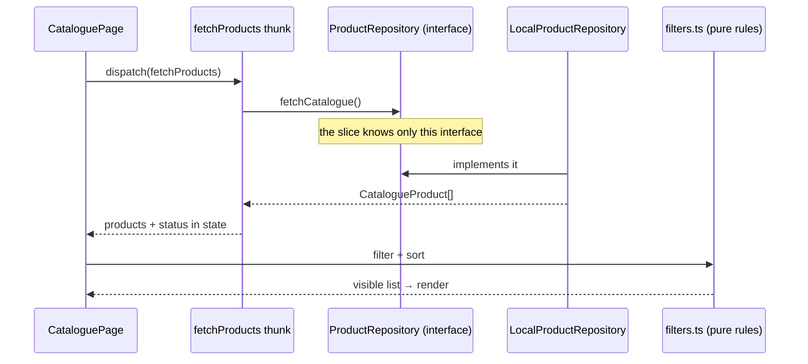

# Clean Architecture Flow — Explained for Juniors

How this codebase is organized and why. Every example links to real files, so you can open them while reading. For the full theory, see [clean-architecture.md](clean-architecture.md) — but you don't need it to follow along here.

## The one-sentence idea

> **Keep the important code (business rules) at the center, and make everything else (UI, database, API) depend on it — never the other way around.**

If tomorrow you swap React for Vue, or the fake API for a real one, the important code doesn't change. That's the whole point.

## A restaurant analogy

Think of the codebase as a restaurant:

| Restaurant | Code layer | Folder | Job |
|---|---|---|---|
| Customer | **Presentation** | `presentation/` | Looks at the menu, places an order (React components) |
| Waiter | **Application** | `application/` | Takes the order, tells the kitchen what to do (Redux slices + thunks) |
| Order slip | **Port** | `application/ports/` | A fixed format: *any* kitchen that reads this slip can cook the order (an interface) |
| Kitchen | **Domain** | `domain/` | Knows *how* to cook — the actual recipes, no knowledge of who the customer is (pure business rules) |
| Supplier | **Infrastructure** | `infrastructure/` | Delivers ingredients; if the supplier changes, the kitchen doesn't care (fake/real APIs) |
| Manager | **Composition root** | `shared/store/store.ts` | Hires the staff before opening — the only one who knows exactly which kitchen, waiter, and supplier exist |

Key rule: the **kitchen never talks to the customer directly**. Orders go through the waiter, in a fixed slip format. Same in code — the inner layers never know the UI exists.

## The layers in this repo

Each feature (`catalogue`, `purchase`, `session`) has the same four folders:

```
features/catalogue/
├── domain/            # Pure business rules. Imports NOTHING.
├── application/       # Redux slices + thunks ("use cases"). Imports domain only.
│   └── ports/         # Interfaces the application needs (e.g. a product repository)
├── infrastructure/    # Implements the ports. All fake "network" lives here.
├── presentation/      # React components. Dispatch thunks, render state.
└── index.ts           # What the feature exposes to the outside
```

**The arrow rule:** `presentation → application → domain`. Nothing ever imports inward-to-outward. Infrastructure is special: it *implements* interfaces from `application`, so the dependency still points inward.

## Flow 1 — Loading the catalogue (the full round trip)

What happens when the dashboard opens:

1. **User opens the page.** [CataloguePage.tsx](../features/catalogue/presentation/CataloguePage.tsx) (presentation) says: "I need products!" by dispatching `fetchProducts()`. It has no idea *how* products are fetched — and that's good.
2. **The use case runs.** [catalogue-slice.ts](../features/catalogue/application/catalogue-slice.ts) (application) handles it. Look at the thunk — it calls `extra.catalogueProducts.fetchCatalogue()`. What is `extra`? A dependency that was *given* to it. The slice only knows the **port**: [product-repository.ts](../features/catalogue/application/ports/product-repository.ts) — an interface that promises "someone out there can fetch products."
3. **The adapter delivers.** [product-repository.ts](../features/catalogue/infrastructure/product-repository.ts) (infrastructure) implements that interface. It fakes a network delay, then converts raw data rows into `CatalogueProduct` objects. Raw API shapes stop here — they never go deeper.
4. **State updates.** The slice stores the products and sets status to `succeeded`.
5. **Business rules compute the view.** Before rendering, [filters.ts](../features/catalogue/domain/filters.ts) (domain) filters and sorts the products. These are pure functions: same input → same output, no network, no React.
6. **The UI renders.** [ProductGrid.tsx](../features/catalogue/presentation/ProductGrid.tsx) draws the cards.



## Flow 2 — Buying a device (domain rules in action)

1. [DetailPage.tsx](../features/purchase/presentation/DetailPage.tsx) loads a product, then [BuyButton.tsx](../features/purchase/presentation/BuyButton.tsx) dispatches `buyProduct()`.
2. [purchase-slice.ts](../features/purchase/application/purchase-slice.ts) reads the selected product and wallet balance from state, then calls the port: `extra.purchaseProducts.buy(product, balance)`.
3. [product-repository.ts](../features/purchase/infrastructure/product-repository.ts) fakes the "network call" and asks the **domain** for the decision: [purchase.ts](../features/purchase/domain/purchase.ts) — `decidePurchase()` checks stock first, then balance. No Redux, no React, just rules.
4. The result (`success` or `insufficient_balance`) flows back up into state.
5. [ResultDialog.tsx](../features/purchase/presentation/ResultDialog.tsx) shows the right dialog.

Notice: the *decision logic* lives in the domain, not in the button component. The button only says "buy"; the kitchen decides if the order can be cooked.

## Flow 3 — Where everything gets connected (the composition root)

**Composition root** = the one place where all concrete classes get created and wired together. It sits at the app's outermost edge, because *someone* has to know the details. In this repo it's [store.ts](../shared/store/store.ts):

```typescript
// shared/store/store.ts — the ONLY file that says `new` on adapters
thunk: {
  extraArgument: {
    userRepository: new LocalUserRepository(),
    catalogueProducts: new CatalogueLocalProductRepository(),
    purchaseProducts: new PurchaseLocalProductRepository(),
  },
},
```

Everywhere else, code depends on **interfaces**. The slice says "give me something with `fetchCatalogue()`" — it never constructs anything itself. The wiring is allowed to point outward exactly once, here, at startup.

Want a real backend later? Write `ApiProductRepository` implementing the same port, change **one line** in `store.ts`, and touch nothing else. That's the payoff of this architecture.

## Why juniors should care: the tests

| Test | What it proves | Mocks needed |
|---|---|---|
| [filters.test.ts](../features/catalogue/domain/filters.test.ts) | Filter/sort rules work | **Zero** |
| [purchase.test.ts](../features/purchase/domain/purchase.test.ts) | Purchase rules work | **Zero** |

Domain code imports nothing, so tests are just: call function, check result. No database to start, no browser to launch, results in milliseconds.

## FAQ (questions juniors actually ask)

**Q: Is `filters.ts` a controller?**
No. It's the **domain** — pure business rules. Controllers convert outside input into use-case calls; here that job belongs to components like `CataloguePage.tsx` translating a click into `dispatch(setSort(...))`.

**Q: What's a "port"?**
Just an interface (a TypeScript `interface` with methods) that the inner layer defines and the outer layer implements. The slice says "I need *something* that can fetch products" — it doesn't care what.

**Q: What's a "composition root"?**
Fancy name for *the wiring file at the app's entry point* (like `main()`). It's the only place allowed to create concrete adapters and hand them to the rest of the app — see Flow 3. Restaurant version: the manager, who hires the staff before doors open.

**Q: Why does `index.ts` export the repository?** ([catalogue/index.ts](../features/catalogue/index.ts))
Only so the composition root can import it. App code should use the feature's public API, not reach into its internals.

**Q: Why is the fake API in its own folder instead of inside the slice?**
So the slice stays testable and replaceable. Mix them, and you can't test the slice without the "network", and you can't swap the "network" without touching business logic.

**Q: When is this overkill?**
For a simple CRUD page with no real rules, four folders is ceremony. This repo is a learning example — use the full structure when business rules get complex.

## Cheat sheet

1. `domain/` = rules. Imports nothing. Pure functions and types.
2. `application/` = orchestration. Redux slices + thunks. Knows domain + its own ports.
3. `infrastructure/` = details. Implements ports, maps raw data → domain types.
4. `presentation/` = screens. Dispatch thunks, render state. No business rules.
5. [store.ts](../shared/store/store.ts) = the only place concrete classes meet.

**Quick test for any file:** "If I deleted React and Redux from the project, would this file still make sense?" If yes → it's domain. If no → it belongs somewhere further out.
