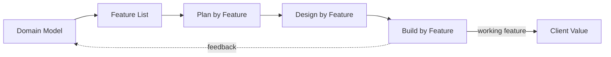
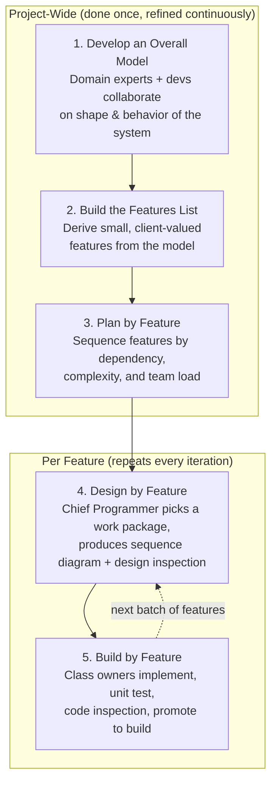

# Feature-Driven Development (FDD): A Practical Reference & Implementation Guide

> A comprehensive guide covering FDD as an agile methodology, feature-based project organization as an architectural approach, and how they combine to produce scalable, maintainable software.

---

## Table of Contents

1. [Overview](#overview)
2. [Important Distinction: Methodology vs. Architecture](#important-distinction-methodology-vs-architecture)
3. [Core Principles](#core-principles)
4. [Methodology](#methodology)
5. [Project Structure](#project-structure)
6. [Implementation Guidelines](#implementation-guidelines)
7. [Best Practices](#best-practices)
8. [Architecture Comparisons](#architecture-comparisons)
9. [Real-World Examples](#real-world-examples)
10. [References](#references)

---

## Overview

**Feature-Driven Development (FDD)** is an agile software development methodology created by **Jeff De Luca** in 1997 during a large-scale (150-person) banking project in Singapore, building on Peter Coad's ideas of fine-grained, feature-based development. It was popularized in *Java Modeling in Color with UML* (Coad et al., 1999) and *A Practical Guide to Feature-Driven Development* (Palmer & Felsing, 2002).

FDD organizes all planning, design, and delivery around **small, client-valued features** — units of work that are:

- **Small**: completable in **no more than two weeks** (ideally 2–3 days)
- **Client-valuable**: each delivers visible, meaningful value to a user or stakeholder
- **Expressed as a result**, not a task: phrased as `<action> <result> <object>`, e.g., *"Calculate the total of a sales order"*

### Purpose

- Deliver **tangible, working software frequently and predictably**
- Scale agile practices to **large teams and large codebases** (FDD was designed for 100+ developers, unlike XP/Scrum which target small co-located teams)
- Combine **upfront domain modeling** with **iterative, incremental delivery**

### Key Benefits

| Benefit | Why it matters |
|---|---|
| **Predictable progress** | Progress is tracked per feature with precision; percentages are meaningful because features are uniformly small |
| **Visible, frequent results** | Working features shipped every iteration, not just "sprints completed" |
| **Scales to large teams** | Chief-programmer work packages + class ownership reduce coordination overhead |
| **Strong domain model** | Shared, living model of the business prevents feature-level inconsistency |
| **Quality gates** | Built-in design and code inspections catch defects early |
| **Clear accountability** | Individual class ownership makes responsibility explicit |

### When to Use FDD

**Good fit:**

- Large, complex, long-running projects (enterprise systems, banking, telecom)
- Teams of 10–100+ developers needing coordination structure
- Domains with rich business logic worth modeling explicitly
- Stakeholders who want measurable, fine-grained progress reporting

**Poor fit:**

- Very small teams (ceremony outweighs value)
- Highly exploratory/prototype work where the domain model shifts constantly
- Projects with no stable domain experts available for modeling

---

## Important Distinction: Methodology vs. Architecture

The term "feature-driven" is used in **two related but distinct ways**. Confusing them causes most misapplications of FDD.

| Aspect | **FDD (Methodology)** | **Feature-Based Organization (Architecture)** |
|---|---|---|
| **What it is** | A *process* for planning and delivering software (a sibling of Scrum/XP) | A *code organization* strategy: folder/module structure by business capability |
| **Scope** | Project management + engineering workflow | Source tree, module boundaries, dependency rules |
| **Core artifacts** | Overall model, feature list, feature plan, work packages | Feature directories/modules (e.g., `features/checkout/`) |
| **Question answered** | "How do we *work* feature-by-feature?" | "How do we *structure code* feature-by-feature?" |
| **Examples** | FDD's five processes (Palmer & Felsing, 2002) | Feature-Sliced Design, Vertical Slice Architecture, feature folders |
| **Can exist alone?** | Yes (FDD process over a layered codebase) | Yes (feature folders under Scrum/Kanban) |

**This document covers both.** The methodology (Section 4) tells teams *how to deliver*; the architecture (Section 5) tells codebases *how to stay modular*. They reinforce each other: delivering in small feature slices naturally encourages code that is organized the same way.

---

## Core Principles

FDD is built on eight enabling practices, five of which map directly to the architectural principles below.

### 1. Feature-Based Organization (Domain Object Modeling + Developing by Feature)

Everything — planning, design, code, progress tracking — is organized around features derived from a shared domain model. The feature is the **single unit of planning, work, and measurement**.



### 2. Modularity

Each feature is a self-contained work package and (ideally) a self-contained code module. Well-formed features can be built, tested, and released with minimal knowledge of other features.

### 3. Separation of Concerns

- **Methodology level**: Chief Programmer separates *design* (high-level) from *implementation* (class owners); planning is separated from building.
- **Architecture level**: each feature module separates its own UI, logic, and data access internally — instead of scattering those concerns across global technical layers.

### 4. Individual Class Ownership

Every class/module has exactly one owner. This creates deep expertise, avoids "everyone edits everything" chaos, and makes ownership traceable — the precursor to today's CODEOWNERS convention.

### 5. Reusability & Shared Components

The domain model reveals shared concepts (e.g., `Customer`, `Money`) that become reusable classes/modules. In code organization, this becomes a `shared/` layer of business-agnostic, reusable building blocks.

### 6. Maintainability

Small features + clear ownership + inspections = code that stays understandable. New developers can be onboarded feature-by-feature; changes to a feature rarely ripple globally.

### 7. Inspections & Regular Builds

Design and code inspections (quality gates before promotion to build) plus frequent integration builds keep quality consistent and integration debt low.

### 8. Feature Teams

Small, cross-functional groups (a chief programmer + 3–6 developers) form dynamically around features, dissolving and reforming as work demands — an early form of what are now called "feature teams" or "stream-aligned teams."

---

## Methodology

### The Five Processes

FDD defines five sequential-then-iterative processes. **Processes 1–3 are initial project-wide activities; processes 4–5 repeat per feature, every iteration.**



#### Process 1 — Develop an Overall Model

- Domain experts and senior developers walk through the domain together.
- Produce a high-level object/domain model (class diagrams, key relationships).
- Goal is a **shared shape and vocabulary**, not exhaustive detail.

#### Process 2 — Build the Features List

- Derive features from the model using the naming pattern: **`<action> <result> <object>`**.
- Group features into **feature sets** (business-related groups), and feature sets into **major feature sets** (areas).

```
Major set:  Sell Products
  Set:      Manage Sale
    Feature: Calculate the total of a sale
    Feature: Apply a discount to a sale line
    Feature: Validate the payment of a sale
  Set:      Manage Inventory
    Feature: Reserve stock for a sale line
```

A feature that takes more than two weeks is **split** into smaller features.

#### Process 3 — Plan by Feature

- The development manager, chief programmers, and project manager sequence features based on dependencies, complexity, and team load.
- Features are assigned to chief programmers as **work packages**; classes to owners.

#### Process 4 — Design by Feature

- The chief programmer selects the next work package, produces **sequence diagrams** for the feature, writes a design note, and holds a **design inspection**.
- Output: a finalized design handed to class owners.

#### Process 5 — Build by Feature

Class owners, per feature:

1. Implement classes and methods
2. **Code inspection** (conformance to standards + correctness)
3. **Unit test** (class-level and feature-level)
4. **Promote to build** — the feature is now "complete" and visible in the build

### Progress Tracking

Because every feature is ≤2 weeks of work, progress can be tracked with precision:

```
Feature: Calculate the total of a sale
  ◼ Domain walkthrough   ◼ Design        ◼ Design inspection
  ◼ Code                 ◼ Code inspection ◼ Promote to build
```

Each checkbox has a defined completion date, giving stakeholders a real completion forecast (this is the origin of "burn-up" style per-feature tracking, predating many modern burndown practices).

---

## Project Structure

Feature-based organization mirrors the methodology: the source tree is sliced **vertically by business capability**, not horizontally by technical layer.

### The Problem with Layer-Based Structure

```
src/
  components/     # 200+ mixed components from every domain
  services/       # every API call, mixed together
  hooks/          # "hook soup"
  utils/          # junk drawer
  stores/         # one god-store
```

A change to one feature touches 5+ directories; ownership is unclear; deletion of a feature requires archaeology.

### Recommended Feature-Based Structure (Frontend — React/Next.js)

```text
src/
  app/                      # routing, providers, global config (composition root)
    layout.tsx
    page.tsx
    dashboard/
    checkout/
  shared/                   # business-agnostic, reusable primitives
    ui/                     # Button, Input, Modal (or shadcn/ui)
    lib/                    # api-client, formatters, date helpers
    config/
  entities/                 # business entities + their domain logic/UI
    user/
    product/
    order/
  features/                 # user interactions — each is a vertical slice
    auth-login/
    product-add-to-cart/
    checkout-place-order/
    order-cancel/
  widgets/                  # large page sections composing features + entities
    product-details/
    cart-summary/
```

> This is the **Feature-Sliced Design (FSD)** methodology — the most developed frontend formalization of feature-based organization, with explicit layer import rules (a layer may only import from layers *below* it). See [feature-sliced.design](https://feature-sliced.design/).

**Simplified variant** (good for small-to-medium projects — less ceremony):

```text
src/
  app/
  features/
    auth/
      components/
      hooks/
      api/            # RTK Query endpoints for this feature
      store/          # feature slice (Redux Toolkit)
      schema.ts       # Zod schemas
      index.ts        # PUBLIC API — the only entry point
    checkout/
    products/
  shared/
  lib/
```

### Recommended Structure (Backend — Node/NestJS-style)

```text
src/
  modules/
    orders/
      orders.controller.ts
      orders.service.ts         # application logic
      orders.repository.ts      # data access
      orders.entity.ts          # domain model
      orders.dto.ts
      orders.module.ts
    payments/
      payments.controller.ts
      payments.service.ts
      stripe/
      payments.module.ts
  shared/
    database/
    config/
    common/
```

**Dependency rule:** features may depend on `shared/` and on well-defined public APIs of other features — never reach into another feature's internals.

### Feature Internal Anatomy

Inside a feature, apply whatever internal layering fits its size:

```text
features/checkout/
  components/     # UI specific to this feature
  hooks/          # feature-specific state/effects
  api/            # data fetching for this feature
  store/          # feature-scoped state slice
  model/          # feature domain logic (pure, testable)
  __tests__/      # feature tests (unit + integration)
  index.ts        # public API — exports ONLY what others may use
```

---

## Implementation Guidelines

### Guideline 1: Define the Feature Boundary Before Coding

Name the feature after a user-valued outcome, not a technical concern.

```text
❌ features/user-data-processing/     # technical, meaningless
✅ features/auth-login/               # action + object
✅ features/order-tracking/           # capability
```

### Guideline 2: Encapsulate Each Feature Behind a Public API

Everything in a feature folder is private unless exported from `index.ts`.

```typescript
// features/cart/index.ts — the feature's public API
export { CartSummary } from './components/cart-summary';
export { useCart } from './hooks/use-cart';
export type { CartItem } from './model/types';
// Internal files (implementation details) stay unexported.
```

### Guideline 3: Keep Feature Logic Pure and Testable

Separate the feature's domain logic from its UI/IO so it can be tested without rendering:

```typescript
// features/checkout/model/pricing.ts — pure domain logic
export function calculateTotal(items: CartItem[], discountPct = 0): Money {
  const subtotal = items.reduce((sum, i) => sum.add(i.price.multiply(i.qty)), Money.zero());
  return subtotal.applyDiscount(discountPct).round();
}

// features/checkout/hooks/use-checkout.ts — orchestration only
export function useCheckout() {
  const { items } = useCart();
  const [discount, setDiscount] = useState(0);
  const total = useMemo(() => calculateTotal(items, discount), [items, discount]);
  const placeOrder = usePlaceOrderMutation()[0];
  return { total, discount, setDiscount, placeOrder };
}
```

### Guideline 4: Register Features in the Composition Root

Features declare; `app/` composes. This keeps routing and providers centralized while logic stays distributed.

```typescript
// app/dashboard/page.tsx
import { SalesOverview } from '@/features/sales-overview';
import { InventoryAlerts } from '@/features/inventory-alerts';

export default function DashboardPage() {
  return (
    <main>
      <SalesOverview />
      <InventoryAlerts />
    </main>
  );
}
```

### Guideline 5: Share State Carefully

- Feature state lives **inside** the feature (Redux Toolkit slice, local state, RTK Query tags).
- Only genuinely global state (session, theme) goes to `app/` or `shared/`.
- Cross-feature communication happens via the public API, events, or a thin coordinating layer — not by reaching into another feature's store.

```typescript
// features/cart/store/cart-slice.ts (Redux Toolkit — feature-scoped)
const cartSlice = createSlice({
  name: 'cart',
  initialState,
  reducers: {
    itemAdded(state, action: PayloadAction<CartItem>) {
      state.items.push(action.payload);
    },
  },
});
```

### Guideline 6: Test at the Feature Seam

| Test level | What to test | Where |
|---|---|---|
| Unit | Pure feature logic (`model/`) | `features/*/model/*.test.ts` |
| Integration | Hook + API + store wiring | `features/*/__tests__/` |
| E2E | User journey across features | `e2e/checkout.spec.ts` |

```typescript
// features/checkout/model/pricing.test.ts
test('applies discount and rounds correctly', () => {
  const items = [{ price: Money.of(10.00), qty: 3 }];
  expect(calculateTotal(items, 10).toString()).toBe('27.00');
});
```

### Guideline 7: Follow the FDD Delivery Loop for Each Feature

Even without adopting full FDD process, mimic its engineering loop:

1. Design note (even one paragraph) → 2. Implement → 3. Unit test → 4. Code review (= inspection) → 5. Merge to main (= promote to build). A feature is "done" only after step 5.

---

## Best Practices

### Feature Boundaries

- **Slice by business capability**, not by technical concern or route ("checkout" not "checkout-components").
- **Size check**: if a feature needs sub-features inside sub-features, your boundary is wrong — split by user action.
- **Rule of thumb**: could this feature be deleted without touching other features? If not, dependencies have leaked.

### Dependency Management

- **Enforce layering mechanically**: `app → widgets → features → entities → shared` (FSD), or `features → shared`. Use ESLint `import/no-restricted-paths` or `boundaries` plugin rather than convention alone.

```js
// .eslintrc — enforce that features never import each other's internals
{
  rules: {
    'import/no-restricted-paths': ['error', {
      zones: [{
        target: './src/features',
        from: './src/features',
        except: ['./index.ts'], // only public APIs cross feature lines
      }],
    }],
  },
}
```

- **Cycles are a defect.** If feature A and B mutually depend, extract the shared concept into `entities/` or `shared/`, or introduce a coordinating feature/widget.
- **Shared upward, features downward**: business-agnostic code goes to `shared/`; shared *business* concepts go to `entities/`. Never let `shared/` import features.

### Shared Components

- A component earns its place in `shared/` only after it is duplicated across **two or more features** (avoid premature generalization).
- Keep `shared/ui` presentational and dumb; feature-specific behavior stays in features.
- Version or document shared components; a shared folder nobody owns becomes a dumping ground.

### Scalability

- **Monorepo-friendly**: each feature folder maps naturally to a workspace package or module when the app outgrows a single repo.
- **Code splitting**: feature entry points are natural dynamic-import boundaries:

```typescript
const CheckoutFlow = dynamic(() =>
  import('@/features/checkout').then(m => m.CheckoutFlow)
);
```

- **Team alignment**: assign feature folders to teams/owners (CODEOWNERS); parallel work stops colliding.

### Testing Strategy

- **Test pyramid per feature**: many unit tests on pure logic, fewer integration tests on the seam, E2E on critical journeys only.
- **Feature fixtures**: each feature exports test fixtures/mocks via a `__mocks__` or `testing.ts` entry so consumers can stub it cleanly.
- **Contract tests** on public APIs when features are developed by different teams.

### Common Pitfalls & Anti-Patterns

| Anti-Pattern | Symptom | Fix |
|---|---|---|
| **Feature sprawl** | Dozens of one-file "features" | Boundary = capability, not component; group small interactions |
| **God feature** | One feature folder owns half the app | Split by user action; extract entities |
| **Cross-feature imports** | `features/a/components/x.ts` imported by feature B | Enforce public-API-only imports with lint rules |
| **Premature `shared/`** | Shared layer full of single-use code | Promote to shared only on second use |
| **Leaky shared layer** | `shared/` contains business logic | Shared = business-agnostic; business concepts → `entities/` |
| **Circular dependencies** | A ↔ B mutual imports | Introduce entities/widgets layer or event-based decoupling |
| **Copy-paste drift** | Similar logic diverges across features | Extract entity/domain module with tests |
| **FDD ceremony without modeling** | Feature lists with no domain model → inconsistent features | Do Process 1 first, even lightweight |
| **Features > 2 weeks** | Endless "in progress" features | Split — this is FDD's core discipline |

---

## Architecture Comparisons

### FDD-Style Feature Organization vs. Alternatives

| Dimension | **Feature-Based (FDD/FSD/VSA)** | **Clean Architecture** | **Atomic Design** | **Layer-Based (Traditional)** |
|---|---|---|---|---|
| Organizing axis | Business capability (vertical slices) | Dependency direction & domain purity | Component composition granularity | Technical concern (horizontal layers) |
| Primary artifact | Feature module | Domain entities + use cases | Atoms → molecules → organisms | Controllers, services, repositories |
| Best at | Scaling *teams & codebase* in parallel; feature velocity | Domain logic independence from frameworks/UI | Consistent, reusable component systems | Simple CRUD apps; small teams |
| Weak at | Cross-feature concepts need discipline (entities layer) | Frontend UI organization; can be ceremonious | Tells you nothing about business logic | Change amplification; unclear ownership |
| Change locality | High (one feature = one folder) | Medium (feature = touches use case + presenter + UI) | Medium (component hierarchy, not feature) | Low (change ripples across layers) |

### They Complement Each Other

These are answers to **different questions** and can be layered:

- **FDD/feature folders** answer *"how do we organize and deliver work?"*
- **Clean Architecture** answers *"how do we keep domain logic independent and testable?"*
- **Atomic Design** answers *"how do we design a consistent component system?"*

#### FDD + Clean Architecture (per-feature layering)

Apply Clean layering *inside* each feature instead of globally:

```text
features/checkout/
  domain/         # pure entities + rules (CalculateTotal) — no framework imports
  application/    # use cases (PlaceOrder) — orchestration
  infrastructure/ # API clients, persistence adapters
  ui/             # React components (presentation)
```

Dependency rule holds *within* the feature: `ui → application → domain`, `infrastructure → domain`. Features stay swappable; domain logic stays pure and testable. This is essentially **Vertical Slice Architecture** (Jimmy Bogard) combined with Clean Architecture.

#### FDD + Atomic Design (shared UI layer)

Atomic Design governs `shared/ui`; features consume atoms/molecules and define their own feature-level organisms:

```text
shared/ui/          # Atomic Design
  atoms/            # Button, Input, Badge
  molecules/        # FormField, SearchBar
  organisms/        # DataTable, Modal
features/checkout/
  components/
    order-summary/  # feature-specific composition (organism, but local)
```

Rule: atoms/molecules never import features. Features compose shared atoms freely.

### Decision Guide

| Situation | Recommendation |
|---|---|
| Small app (< 10 features), small team | Simplified feature folders + layer-based internals |
| Large frontend, multiple teams | FSD-style layers + feature slices + lint boundaries |
| Rich business domain (fintech, ERP) | Feature slices **with Clean Architecture inside each feature** |
| Design-system-heavy product | Feature slices + Atomic Design in `shared/ui` |
| Simple B2 CRUD admin | Plain layer-based is fine — don't over-architect |

---

## Real-World Examples

### Frontend: React / Next.js E-Commerce

```
src/
  app/
    (shop)/products/[slug]/page.tsx
    checkout/page.tsx
  features/
    product-catalog/
    cart-add-to-cart/
    checkout-place-order/
    auth-login/
  entities/
    product/
    order/
    user/
  shared/ui/
```

- `app/checkout/page.tsx` composes widgets/features; the checkout feature owns pricing logic, Stripe integration calls, and its Redux slice.
- Adding "loyalty points" = a new `features/loyalty-points/` folder + one composition line. No edits to catalog or cart internals.

### Frontend: Feature-Sliced Design (formalized, feature-sliced.design)

Used by production teams (e.g., documented case studies on the FSD site): strict 7-layer model (`app → processes → pages → widgets → features → entities → shared`) with lint-enforced import rules. See the [FSD documentation](https://feature-sliced.design/docs) and [Next.js App Router guide](https://feature-sliced.design/blog/nextjs-app-router-guide).

### Backend: NestJS Modules as Features

NestJS's module system is natively feature-oriented:

```typescript
// orders/orders.module.ts
@Module({
  controllers: [OrdersController],
  providers: [OrdersService, OrdersRepository],
  imports: [PaymentsModule, DatabaseModule],
  exports: [OrdersService],   // public API for other features
})
export class OrdersModule {}
```

Each `modules/*` directory is a vertical slice: controller → service → repository → entity. This is FDD's "feature team owns its classes" principle expressed at the framework level.

### Backend: Vertical Slice Architecture (.NET, Jimmy Bogard)

MediatR-based VSA organizes each request as a self-contained feature:

```
src/Features/Orders/
  CreateOrder.cs        # command + handler + validator + endpoint in one file
  GetOrderById.cs
  CancelOrder.cs
```

Same principle — client-valued operations as the unit of organization — in the backend world. See [jimmybogard.com](https://www.jimmybogard.com/vertical-slice-architecture/).

### Large-Scale Origin Case

FDD itself was born at scale: a Singapore banking project with ~150 developers (1997) delivered via the five FDD processes; the methodology was later applied on projects of up to ~500 developers (per Palmer & Felsing, 2002).

---

## References

### Foundational / Official

1. **Palmer, S. & Felsing, J. — *A Practical Guide to Feature-Driven Development* (2002)** — the definitive FDD book; original FDD process descriptions: http://www.featuredrivendevelopment.com/files/fddprocessesA4.pdf
2. **Coad, P., Lefebvre, E., De Luca, J. — *Java Modeling in Color with UML* (1999)** — origin of the feature concept and "developing by feature."
3. **Agile Alliance — Feature-Driven Development**: https://www.agilealliance.org/glossary/fdd/
4. **FDD Process lectures (Pace University / Sharif University course materials)**: http://csis.pace.edu/~marchese/SE616/L2New/jmcuch06.pdf · https://sharif.edu/~ramsin/index_files/sdmlecture10.pdf

### Architecture — Feature-Based Organization

5. **Feature-Sliced Design (official docs)** — the most formalized frontend feature methodology: https://feature-sliced.design/
6. **FSD — The Ultimate Next.js App Router Architecture**: https://feature-sliced.design/blog/nextjs-app-router-guide
7. **FSD — The Perfect Folder Structure for Scalable Frontend**: https://feature-sliced.design/blog/frontend-folder-structure
8. **Jimmy Bogard — Vertical Slice Architecture**: https://www.jimmybogard.com/vertical-slice-architecture/

### Comparisons & Complementary Architectures

9. **Uncle Bob — The Clean Architecture**: https://blog.cleancoder.com/uncle-bob/2012/08/13/the-clean-code-blog.html
10. **Brad Frost — Atomic Design**: https://atomicdesign.bradfrost.com/
11. **freeCodeCamp — Reusable Architecture for Large Next.js Applications**: https://www.freecodecamp.org/news/reusable-architecture-for-large-nextjs-applications

### Guides & Overviews

12. **monday.com — Feature-Driven Development: The Complete Guide**: https://monday.com/blog/rnd/feature-driven-development-fdd/
13. **Umbrex — Agile & Iterative Delivery: Feature-Driven Development**: https://umbrex.com/resources/frameworks/project-management-frameworks/feature-driven-development-fdd/

---

*Last updated: 2026-10-29*
