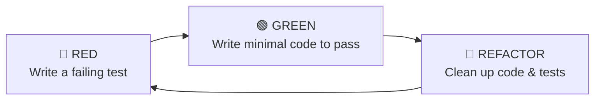
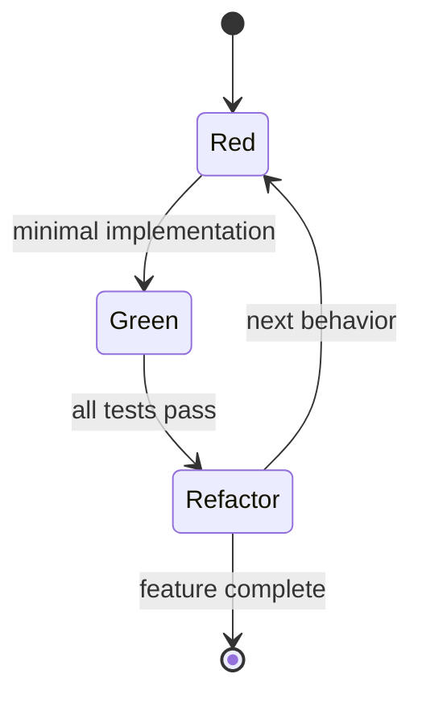
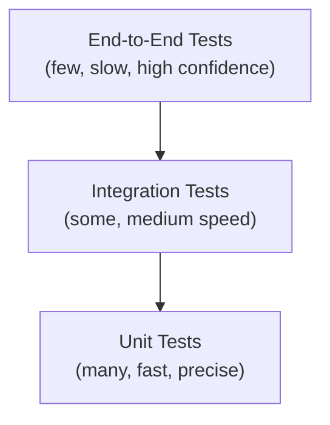
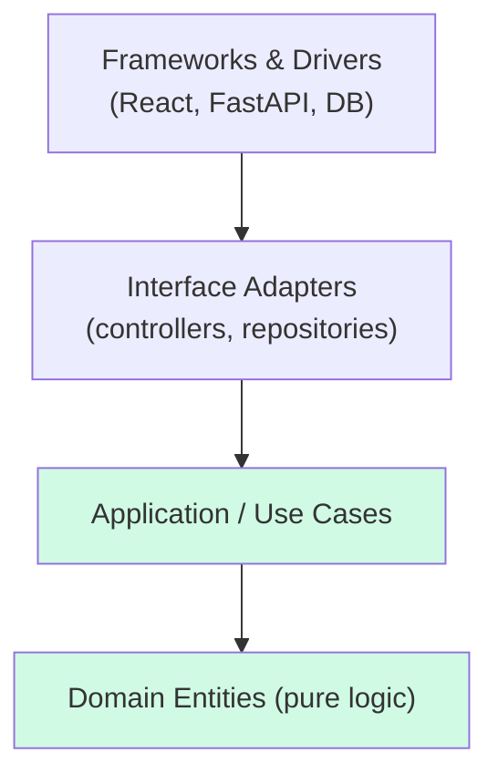

# Test-Driven Development (TDD) — A Practical Reference & Implementation Guide

> A comprehensive, developer-friendly guide to understanding and applying Test-Driven Development in modern software engineering — covering principles, workflows, strategies, tooling, and architecture integration.

---

## Table of Contents

1. [Overview](#1-overview)
2. [Core Principles](#2-core-principles)
3. [TDD Lifecycle: Red–Green–Refactor](#3-tdd-lifecycle-redgreenrefactor)
4. [Testing Strategies](#4-testing-strategies)
5. [Implementation Guidelines](#5-implementation-guidelines)
6. [Project Structure](#6-project-structure)
7. [Best Practices](#7-best-practices)
8. [Architecture Integration](#8-architecture-integration)
9. [Methodology Comparisons](#9-methodology-comparisons)
10. [Tools and Frameworks](#10-tools-and-frameworks)
11. [Real-World Examples](#11-real-world-examples)
12. [References](#12-references)

---

## 1. Overview

### 1.1 What is TDD?

**Test-Driven Development (TDD)** is a software development technique in which **tests are written before the production code** they validate. It was developed by **Kent Beck** in the late 1990s as part of **Extreme Programming (XP)** and popularized in his book *Test-Driven Development: By Example* (2002).

Martin Fowler emphasizes the key framing:

> "TDD is a technique for **building** software, not a technique for **testing** software." — [Martin Fowler](https://martinfowler.com/testing/)

The tests are not merely verification artifacts — they are a **design tool**. Writing a test first forces you to think about the interface, inputs, outputs, and behavior *before* implementation details constrain your thinking.

### 1.2 Purpose

| Purpose | Explanation |
|---|---|
| **Executable specification** | Tests describe what the code *should* do, in code. |
| **Design pressure** | Test-first writing produces loosely coupled, testable designs by necessity. |
| **Safety net** | A comprehensive suite enables fearless refactoring. |
| **Fast feedback** | Defects are caught seconds after being introduced, not weeks later. |
| **Living documentation** | The test suite documents expected behavior and never goes stale (it fails if it does). |

### 1.3 Key Benefits

- **Higher code quality** — defects are caught at the moment of creation; studies (e.g., Nagappan et al., Microsoft/IBM, *Empirical Studies on TDD*, 2008) show significant defect-rate reductions on TDD teams.
- **Better design** — code written to be test-first is inherently decoupled and dependency-injected.
- **Confidence in refactoring** — green tests make large-scale change safe.
- **Reduced debugging time** — you always know which change broke what.
- **Psychological safety** — developers ship with certainty rather than hope.

### 1.4 Limitations

- **Steeper learning curve** — writing good tests *first* is a skill that takes months to build.
- **Slower initial velocity** — teams commonly write 15–35% more code initially (tests included), though total lifecycle cost often drops.
- **Not all code is test-first friendly** — exploratory prototypes, throwaway spikes, and pure UI layout often benefit less.
- **Risk of low-value tests** — testing getters/setters or over-mocked tests add cost without protection.
- **Legacy systems** — adopting TDD in tightly coupled legacy code requires seam-introduction work first (see Feathers, *Working Effectively with Legacy Code*).

### 1.5 When to Use It

| Use TDD when… | Consider alternatives when… |
|---|---|
| Business logic is complex or rules-heavy | Building a quick throwaway prototype/spike |
| The code will live and evolve for years | Styling/layout tweaks (visual verification wins) |
| Integration points and contracts must be stable | Glue code with trivial logic |
| Refactoring is expected to be frequent | One-off scripts and automation utilities |
| The team values long-term maintainability | Learning a new library interactively |

---

## 2. Core Principles

### 2.1 Test-First Development

Write the test **before** the implementation. This inverts the traditional loop: instead of coding then verifying, you specify expected behavior, watch it fail, then make it pass. The failing test *is* the requirement.

### 2.2 Incremental Development

Behavior is added in **small, discrete steps** — one failing test at a time. Each cycle produces a working, tested increment. No big design upfront; the design *emerges* from the accumulating tests.

### 2.3 Fast Feedback Loops

TDD loops should run in **seconds, not minutes**. Fast tests mean you run them constantly, which means you find breakage within seconds of causing it. If your loop is slow, you will stop running it — and TDD dies.

### 2.4 Simplicity (YAGNI)

You Only Write What the Test Requires. "Fake it till you make it" and triangulation allow you to grow generality only when a test demands it — never speculatively.

### 2.5 Continuous Refactoring

Refactoring is not optional housekeeping — it is **one of the three mandatory steps** of every cycle. After green, improve names, remove duplication, and extract structure *while the safety net is green*.

### 2.6 The Three Laws of TDD (Robert C. Martin)

From *Clean Code* (2008) — these laws lock you into the test-first loop:

1. **Do not write any production code** except to pass a failing test.
2. **Do not write more of a test** than is sufficient to fail (compilation failure counts as failure).
3. **Do not write more production code** than is sufficient to pass the currently failing test.

### 2.7 The Two Rules of TDD (Kent Beck)

> 1. Write new code only if an automated test has failed.
> 2. Eliminate duplication.

Everything else — the cycle, the tools — follows from these two rules. — [TDD: By Example, ch. 26](https://www.oreilly.com/library/view/test-driven-development/0321146530/)

---

## 3. TDD Lifecycle: Red–Green–Refactor

The TDD heartbeat is a short, repeating cycle:





### 3.1 🔴 RED — Write a Failing Test

Write a small test that describes the *next* behavior you want. Run it and **watch it fail**.

**Why watch it fail?** A test that never failed might be a false positive — always-green tests protect nothing. Failure confirms the test actually exercises the code.

Practical example — a discount calculator (TypeScript):

```typescript
// discount.test.ts
import { describe, it, expect } from "vitest";
import { calculateDiscount } from "./discount"; // does not exist yet

describe("calculateDiscount", () => {
  it("gives no discount below $100", () => {
    expect(calculateDiscount(50)).toBe(0);
  });
});
```

Failure mode: `Cannot find module './discount'` (a compilation/import failure counts as RED per Law 2).

### 3.2 🟢 GREEN — Write Minimal Code to Pass

Write the **simplest** code that makes the test pass. Resist the urge to implement everything you anticipate.

```typescript
// discount.ts — minimal, deliberately incomplete
export function calculateDiscount(amount: number): number {
  return 0;
}
```

All tests green. It feels like cheating — it isn't. The next test drives the next behavior.

### 3.3 🔵 REFACTOR — Improve Structure, Keep It Green

Now improve the code *without changing behavior*: remove duplication, clarify names, extract functions. Tests must stay green throughout.

Next RED test (drives real logic):

```typescript
it("gives 10% discount at or above $100", () => {
  expect(calculateDiscount(100)).toBe(10);
});
```

Minimal GREEN:

```typescript
export function calculateDiscount(amount: number): number {
  return amount >= 100 ? amount * 0.1 : 0;
}
```

REFACTOR — magic numbers extracted, boundary documented:

```typescript
const DISCOUNT_THRESHOLD = 100;
const DISCOUNT_RATE = 0.1;

export function calculateDiscount(amount: number): number {
  if (amount < DISCOUNT_THRESHOLD) return 0;
  return amount * DISCOUNT_RATE;
}
```

Run tests → still green → next behavior.

### 3.4 Cycle Rules

- **One test per cycle.** Small cycles = small steps = fewer mistakes.
- **Never refactor on red.** Fix the code first, then clean up.
- **Commit on green.** Each green state is a safe restore point.
- **If stuck red for >15 minutes**, revert and take smaller steps.

---

## 4. Testing Strategies

TDD is primarily a **unit-level** methodology, but unit tests live within a broader strategy. Test frameworks are tools; strategies are how you combine test types; TDD is the *development methodology* — see [Methodology Comparisons](#9-methodology-comparisons).

### 4.1 The Test Pyramid



| Level | Scope | Speed | Count | TDD usage |
|---|---|---|---|---|
| **Unit** | One function/class, dependencies doubled | ms | Many | Primary TDD driver |
| **Integration** | Multiple modules together (real DB, real HTTP) | 100ms–s | Some | TDD at service boundaries |
| **End-to-End** | Whole system through the UI/API | s–min | Few | Usually written after, or outside TDD |

Reference: [Fowler — Test Pyramid](https://martinfowler.com/bliki/TestPyramid.html)

### 4.2 Test Doubles

Gerard Meszaros's taxonomy (*xUnit Test Patterns*):

| Double | Purpose | Verification style |
|---|---|---|
| **Dummy** | Fills a parameter list; never used | — |
| **Stub** | Returns canned answers; puts SUT in a state | State (assert on return values) |
| **Spy** | A stub that records calls for later inspection | Behavior, checked after |
| **Mock** | Pre-programmed with expectations of calls it *must* receive | Behavior, checked during |
| **Fake** | Working lightweight implementation (in-memory DB) | State |

```typescript
// Stub — state verification
const paymentGateway: PaymentGateway = {
  charge: vi.fn().mockResolvedValue({ status: "success" }),
};
const result = await checkout(cart, paymentGateway);
expect(result.success).toBe(true);

// Mock — behavior verification
const emailer: EmailService = { send: vi.fn() };
await checkout(cart, paymentGateway, emailer);
expect(emailer.send).toHaveBeenCalledWith(
  expect.objectContaining({ orderId: expect.any(String) })
);
```

### 4.3 Mock Boundaries: Mock Only What You Own

The guiding rule: **use the real thing when it is controllable and fast; double it when it is uncontrollable or slow.**

- ✅ Mock/double: external APIs, payment gateways, clocks, randomness, message queues.
- ✅ Prefer fakes for databases in fast unit suites (e.g., in-memory repositories); use a real DB in integration tests.
- ❌ Don't mock value objects, pure functions, or third-party libraries' internals — you'd be testing your mocks, not your code.
- **Hexagonal angle:** mock at *ports* (your interfaces), never at implementation details — tests then survive internal refactoring. See [Fowler — Mocks Aren't Stubs](https://martinfowler.com/articles/mocksArentStubs.html).

### 4.4 Outside-In vs. Inside-Out TDD

| Style | Direction | Best for |
|---|---|---|
| **Inside-out (Chicago school)** | Start from domain units, build outward | Pure logic, libraries, algorithms |
| **Outside-in (London school)** | Start from an acceptance-level test, mock collaborators, drill inward | Feature work in layered/hexagonal apps, FDD-style features |

Both are valid TDD; teams often blend them — outside-in for feature scaffolding, inside-out for complex domain logic.

---

## 5. Implementation Guidelines

### 5.1 Step-by-Step: Full Red–Green–Refactor Example (Python)

**Scenario:** a password validator — reject passwords shorter than 8 characters.

**Cycle 1 — RED** (test fails: module doesn't exist):

```python
# tests/test_password_validator.py
import pytest
from app.password_validator import validate


def test_rejects_short_password():
    assert validate("abc") is False
```

**Cycle 1 — GREEN** (minimal):

```python
# app/password_validator.py
def validate(password: str) -> bool:
    return False
```

**Cycle 2 — RED**:

```python
def test_accepts_valid_password():
    assert validate("s3cureP@ss!") is True
```

**Cycle 2 — GREEN**:

```python
def validate(password: str) -> bool:
    return len(password) >= 8
```

**Cycle 2 — REFACTOR** (name the rule):

```python
MIN_LENGTH = 8

def validate(password: str) -> bool:
    return len(password) >= MIN_LENGTH
```

**Cycle 3 — RED** (new rule: must contain a digit):

```python
def test_rejects_password_without_digit():
    assert validate("nodigitshere") is False
```

**Cycle 3 — GREEN**:

```python
import re

MIN_LENGTH = 8

def validate(password: str) -> bool:
    return len(password) >= MIN_LENGTH and bool(re.search(r"\d", password))
```

**Cycle 3 — REFACTOR** (extract predicates as the rules grow):

```python
MIN_LENGTH = 8

def _has_min_length(password: str) -> bool:
    return len(password) >= MIN_LENGTH

def _has_digit(password: str) -> bool:
    return bool(re.search(r"\d", password))

def validate(password: str) -> bool:
    return _has_min_length(password) and _has_digit(password)
```

Notice the design evolution: each refactor step was *forced* by accumulated tests, not speculative foresight. That is TDD's design payoff.

### 5.2 Frontend Example: React with Testing Library (outside-in)

```tsx
// Counter.test.tsx — RED
import { render, screen, fireEvent } from "@testing-library/react";
import { Counter } from "./Counter";

it("increments count on click", () => {
  render(<Counter />);
  expect(screen.getByText("Count: 0")).toBeDefined();
  fireEvent.click(screen.getByRole("button", { name: /increment/i }));
  expect(screen.getByText("Count: 1")).toBeDefined();
});
```

Minimal GREEN, then REFACTOR (extract button labels, a11y roles are already baked in because Testing Library tests *behavior through the UI*, not implementation):

```tsx
export function Counter() {
  const [count, setCount] = useState(0);
  return (
    <div>
      <p>Count: {count}</p>
      <button onClick={() => setCount((c) => c + 1)}>Increment</button>
    </div>
  );
}
```

### 5.3 Practical Adoption Checklist

1. Pick one small, well-understood feature; don't convert a whole codebase at once.
2. Write the first failing test at the level where behavior is observable.
3. Keep cycle time under a few minutes; if longer, split the test.
4. Commit at every green; push at every refactor boundary.
5. Use watch mode (`vitest --watch`, `pytest-watch`, `jest --watch`) to shorten the loop.
6. Add integration tests at real boundaries (DB, HTTP) after the unit-level green.
7. Code review both production code **and** tests.

---

## 6. Project Structure

### 6.1 Frontend (Next.js / React — feature-sliced)

```
src/
├── app/                        # routes / pages (Next.js App Router)
│   └── checkout/
│       └── page.tsx
├── features/
│   └── checkout/
│       ├── components/         # Atomic Design components live here
│       │   ├── atoms/
│       │   ├── molecules/
│       │   └── organisms/
│       ├── hooks/
│       ├── api/
│       ├── __tests__/          # unit tests colocated per feature
│       │   ├── useCart.test.ts
│       │   └── priceSummary.test.ts
│       └── index.ts
├── components/ui/              # shared design-system components + *.test.tsx
├── lib/                        # shared utils + *.test.ts
└── test/
    ├── setup.ts                # jest/vitest setup, matchers
    └── e2e/                    # Playwright specs (separate runner)
e2e/
└── checkout.spec.ts
```

### 6.2 Backend (Python — src layout)

```
project/
├── src/
│   └── app/
│       ├── domain/             # pure business logic (unit-test heavy)
│       │   ├── orders.py
│       │   └── pricing.py
│       ├── adapters/           # DB, HTTP clients (integration-tested)
│       └── api/                # FastAPI/Flask routes (API-level tests)
├── tests/
│   ├── unit/
│   │   └── domain/
│   │       └── test_pricing.py
│   ├── integration/
│   │   └── test_order_repository.py
│   └── e2e/
│       └── test_place_order_api.py
└── pyproject.toml
```

### 6.3 Organization Patterns

| Pattern | Description | Trade-off |
|---|---|---|
| **Colocated** (`foo.test.ts` beside `foo.ts`) | Easy discovery, refactors move together | Noisy source tree |
| **Mirrored `__tests__/` / `tests/` tree** | Clean src, clear test-type separation | Paths can drift |
| **Single top-level `tests/`** | Common in Python/Java | Encourages monolithic suites |
| **Separate e2e project** | Own runner, own CI stage, own timeout budget | Extra tooling |

Recommendation: **colocate unit tests** with source, and keep **integration/e2e in mirrored top-level directories** with separate CI jobs.

---

## 7. Best Practices

### 7.1 Test Isolation

- Each test must be **independent and order-independent** — no shared mutable state.
- Reset fixtures in `beforeEach`/`setUp`; use factories (`factory-bot`, `@faker-js/faker`, test object builders) over shared constants.
- Run suites in parallel and in random order (`vitest --sequence.shuffle`, `pytest -p no:cacheprovider` with `pytest-randomly`) to surface hidden coupling.

### 7.2 Meaningful Assertions

- Assert on **observable behavior**, not implementation details.
- One conceptual assertion per test (`it("rejects expired tokens")`), even if that's several `expect`s.
- Prefer exact expectations (`toBe(10)`) over loose ones (`toBeTruthy()`).
- Assertion messages / custom matchers for non-obvious failures.

### 7.3 Test Readability: Arrange–Act–Assert (or Given–When–Then)

```typescript
it("applies 10% member discount", () => {
  // Arrange
  const order = anOrder().forMember().totaling(200).build();
  // Act
  const total = pricing.totalFor(order);
  // Assert
  expect(total).toBe(180);
});
```

Use **descriptive names** stating behavior and expected outcome. A failing test name should read like a bug report.

### 7.4 Deterministic Tests

Eliminate the four sources of flakiness:

| Source | Fix |
|---|---|
| Time | Inject a `Clock`/`Date` provider; freeze time in tests |
| Randomness | Seed the RNG; inject randomness |
| Concurrency | `await` everything; avoid sleep-based waits (use `waitFor`) |
| External services | Doubles or contract tests; never call real third-party APIs in unit suites |

A flaky test is worse than no test: teams learn to re-run instead of investigate.

### 7.5 Maintainability

- Keep the **test API surface small** — shared setup helpers, builders, fixtures.
- **Update tests through refactoring too** — tests are production code's twin.
- Delete tests that test deleted behavior; don't hoard dead assertions.

### 7.6 Common Anti-Patterns

| Anti-pattern | Symptom | Fix |
|---|---|---|
| **The Liar** | Test that always passes | Watch every test fail at least once; mutate code to verify |
| **The Giant** | One test asserting dozens of behaviors | Split by behavior |
| **The Mockery** | Over-mocking; test asserts the mock was called as written | Mock only at architectural boundaries; prefer fakes/stubs |
| **The Inspector** | Testing private methods/implementation | Test public behavior; if untestable, the design is telling you something |
| **The Flake** | Randomly failing test | Find the nondeterminism (time, random, async, network) |
| **The Slowpoke** | Suite takes minutes; devs stop running it | Split fast unit suite from slow integration suite |
| **The Change-Detector** | Snapshot tests that break on any edit | Assert on semantics, not serialization |
| **Test-after theater** | Tests written after, matching buggy behavior | Genuinely test-first, or at least test-driven design review |

References: [James Carr — TDD Anti-Patterns](https://blog.james-carr.org/2006/08/03/tdd-anti-patterns-collection/) · [Kevlin Henney — Anti-patterns talk](https://www.youtube.com/watch?v=GZYU0FIk83U)

---

## 8. Architecture Integration

### 8.1 TDD + Clean Architecture

Clean Architecture's layering exists precisely to make the domain **testable without infrastructure**:



- **Domain & use cases = pure functions/classes** → unit-test with no mocks at all (the TDD sweet spot).
- **Ports (interfaces)** defined by the use cases become the **only place mocks are needed** — a repository interface is mocked trivially.
- **Adapters** (real DB, HTTP) get thin integration tests.
- TDD *drives* the architecture: the pain of testing a tangled component pushes you toward hexagonal seams. See [The Clean Code Blog — Uncle Bob](https://blog.cleancoder.com/uncle-bob/2012/08/13/the-clean-architecture.html).

### 8.2 TDD + Feature-Driven Development (FDD)

FDD organizes work around a **feature list** ("calculate order tax"), each built in ~2-week increments via: *design → build → test*. TDD fits as the build/test engine:

1. Pick a feature from the list (FDD's unit of planning).
2. Write acceptance-oriented tests for the feature's scenarios (outside-in TDD).
3. Drive each scenario red→green→refactor.
4. Feature is "done" when its tests are green and integrated.

FDD provides the *what and when*; TDD provides the *how* at the code level.

### 8.3 TDD + Atomic Design

Atomic Design (Brad Frost) structures UI as `atoms → molecules → organisms → templates → pages`. TDD applies at each level differently:

| Level | TDD approach |
|---|---|
| **Atoms** (Button, Input) | Unit tests for props, states, a11y roles (React Testing Library) |
| **Molecules/Organisms** | Behavior tests with user events; logic extracted to hooks and TDD'd pure |
| **Templates/Pages** | Integration tests (routing, data fetching with MSW); light e2e coverage |

Key move: **extract logic into custom hooks / view models** and TDD those pure units; render tests then stay few and behavioral. See [Atomic Design by Brad Frost](https://atomicdesign.bradfrost.com/) and [Testing Library guiding principles](https://testing-library.com/docs/guiding-principles/).

---

## 9. Methodology Comparisons

### 9.1 TDD vs. BDD vs. ATDD vs. Test-After

| Aspect | TDD | BDD | ATDD | Test-After |
|---|---|---|---|---|
| **Primary focus** | Code-level behavior | System behavior, shared language | Acceptance criteria / requirements | Verification after the fact |
| **Tests written** | Before each unit | Before each feature (scenarios) | Before the sprint/feature | After implementation |
| **Who writes** | Developers | Devs + PO/QA (three amigos) | Whole team | Developers |
| **Language** | Code | Gherkin (Given/When/Then) + code | Plain text / Gherkin | Code |
| **Artifact** | Unit tests | Executable scenarios (Cucumber) | Acceptance tests | Regression tests |
| **Design influence** | Strong (unit design) | Strong (behavior discovery) | Strong (requirement clarity) | Weak |
| **Bug catch point** | At authoring time | At specification time | At requirement time | Days/weeks later |

Sources: [BrowserStack — TDD vs BDD vs ATDD](https://www.browserstack.com/guide/tdd-vs-bdd-vs-atdd) · [SoftwareTestingMaterial](https://www.softwaretestingmaterial.com/tdd-vs-bdd-vs-atdd/)

### 9.2 Key Distinctions

- **TDD ≠ a testing framework.** Jest/pytest are tools; TDD is a discipline about *when* tests are written and what they drive.
- **BDD extends TDD outward** to business language: same red-green rhythm, but scenarios come from stakeholder conversations. Tools: Cucumber, SpecFlow, Behave.
- **ATDD extends TDD upward** to acceptance criteria: acceptance tests define "done" before the sprint starts; TDD builds the internals to satisfy them.
- **Test-after vs. TDD:** test-after verifies code you already decided to build; TDD *specifies* the code before it exists. Test-after tends to mirror implementation (coupling tests to internals); test-first tends to specify intent.

### 9.3 They Combine Well

A mature loop: **ATDD** defines the acceptance test (requirement) → **BDD** scenarios clarify behavior with stakeholders → **TDD** drives the units that make scenarios pass. One workflow, three altitudes.

---

## 10. Tools and Frameworks

### 10.1 JavaScript / TypeScript

| Tool | Purpose | Notes |
|---|---|---|
| **[Jest](https://jestjs.io/)** | Unit test runner, matchers, mocks | Batteries included; default in CRA-era apps |
| **[Vitest](https://vitest.dev/)** | Jest-compatible, Vite-native | Fast watch mode ideal for TDD loops; current recommendation for Vite/Next projects |
| **[React Testing Library](https://testing-library.com/docs/react-testing-library/intro/)** | Component behavior via DOM queries | Tests behavior, not implementation — pairs perfectly with TDD |
| **[MSW](https://mswjs.io/)** | Network-level API mocking | Integration tests without live backends |
| **[Playwright](https://playwright.dev/)** | Cross-browser e2e | Fast, reliable auto-waiting; trace viewer for failures |
| **[Cypress](https://www.cypress.io/)** | Browser e2e | Great DX, time-travel UI; same-origin limitations vs Playwright |

### 10.2 Python

| Tool | Purpose | Notes |
|---|---|---|
| **[pytest](https://docs.pytest.org/)** | De-facto standard runner | Parametrize, fixtures, rich plugins |
| **[unittest.mock](https://docs.python.org/3/library/unittest.mock.html)** | Doubles (stdlib) | `Mock`, `patch` |
| **[Hypothesis](https://hypothesis.readthedocs.io/)** | Property-based testing | Complements example-based TDD |

### 10.3 Java / JVM

| Tool | Purpose | Notes |
|---|---|---|
| **[JUnit 5](https://junit.org/junit5/)** | Standard runner | Jupiter API, parameterized tests |
| **[Mockito](https://site.mockito.org/)** | Doubles | `mock()`, `verify()`, ArgumentCaptor |
| **[AssertJ](https://assertj.github.io/doc/)** | Fluent assertions | Readable failure messages |
| **[Testcontainers](https://testcontainers.com/)** | Real infra in Docker for integration tests | DB/mq integration tests with real engines |

### 10.4 Supporting Tooling

- **Coverage:** `vitest --coverage` (V8), `pytest --cov`, JaCoCo — as a *map of untested behavior*, never as a target (see [Fowler — Coverage](https://martinfowler.com/bliki/TestCoverage.html)).
- **Watch mode:** essential for tight TDD loops (`vitest`, `pytest-watch`, `jest --watch`).
- **Mutation testing:** [Stryker](https://stryker-mutator.io/) (JS), mutmut (Python) — verifies your tests actually detect bugs.

---

## 11. Real-World Examples

### 11.1 Example 1: Refactoring Confidence

**Scenario:** A payments team must migrate a legacy `InvoiceCalculator` (4,000 lines, no tests) from REST to a message-driven flow.

- **Without TDD:** refactoring is a multi-week freeze, QA regression cycle, and production incident risk.
- **With TDD:** before touching the calculator, the team *characterizes* existing behavior with tests (Feathers' "sprouting" technique), locks behavior in with a green suite, then refactors in small green-committed steps. Shipping continues daily; a regression surfaces within one test run.

**Payoff:** the test suite converts an unsafe rewrite into a sequence of safe, reversible micro-changes.

### 11.2 Example 2: Design Improvement

**Scenario:** A `ReportGenerator` reads from the DB, formats, and emails in one class.

Writing the first test ("generates monthly summary given orders") is impossible without spinning up a database — the design smell is surfaced *by the test's pain*. The developer injects an `OrderRepository` interface, tests run against an in-memory fake, and the class becomes three collaborators: `fetcher`, `formatter`, `sender` — each TDD'd independently.

**Payoff:** TDD didn't just test the design; it *produced* a better one.

### 11.3 Example 3: Long-Term Maintainability

**Scenario:** An e-commerce pricing engine accumulates rules over 3 years: member discounts, bundle pricing, regional taxes, promo stacking.

- Every new rule arrives as a failing test in a 900-test suite; every ambiguous old rule is answered by reading (not debugging) the relevant test.
- When tax law changes, the team deletes the obsolete tax tests (spec update), writes new ones, and implements — the diff *is* the legal change log.

**Payoff:** the suite functions as executable, always-current documentation of pricing policy.

### 11.4 What Good Looks Like

| Signal | Healthy TDD | Unhealthy |
|---|---|---|
| Cycle time | Seconds to green | Minutes/hours |
| Test/style of asserts | Behavioral, few, precise | Implementation-coupled, sprawling |
| Refactoring | Constant, on every cycle | Deferred, feared |
| Flaky tests | ~0; any flake fixed same day | Chronic, "just re-run" |
| New dev onboarding | Reads tests to learn behavior | Reads tests to learn the mocking framework |

---

## 12. References

### Original & Authoritative Sources

1. Kent Beck — *Test-Driven Development: By Example* (Addison-Wesley, 2002) — https://www.oreilly.com/library/view/test-driven-development/0321146530/
2. Martin Fowler — *Test-Driven Development* (bliki) — https://martinfowler.com/testing/
3. Martin Fowler — *Mocks Aren't Stubs* — https://martinfowler.com/articles/mocksArentStubs.html
4. Martin Fowler — *Test Pyramid* — https://martinfowler.com/bliki/TestPyramid.html
5. Martin Fowler — *TestCoverage* — https://martinfowler.com/bliki/TestCoverage.html
6. Robert C. Martin — *Clean Code* ch. 9 (The Three Laws of TDD), 2008 — https://www.pearson.com/en-us/subject-catalog/p/clean-code-a-handbook-of-agile-software-craftsmanship/P200000009044
7. Uncle Bob — *The Clean Architecture* — https://blog.cleancoder.com/uncle-bob/2012/08/13/the-clean-architecture.html
8. Gerard Meszaros — *xUnit Test Patterns: Refactoring Test Code* — https://xunitpatterns.com/
9. Michael Feathers — *Working Effectively with Legacy Code*, 2004 — https://www.pearson.com/en-us/subject-catalog/p/working-effectively-with-legacy-code/P200000009424
10. Brad Frost — *Atomic Design* — https://atomicdesign.bradfrost.com/

### Research

11. Nagappan, Maximilien, Bhat, Williams — *Realizing quality improvement through TDD* (Empirical Software Engineering, 2008) — https://link.springer.com/article/10.1007/s10664-008-9062-z
12. George & Williams — *An Initial Investigation of Test-Driven Development in Industry* (2003) — https://dl.acm.org/doi/10.1145/876938.876949

### Official Documentation

13. Jest — https://jestjs.io/docs/getting-started
14. Vitest — https://vitest.dev/guide/
15. React Testing Library — https://testing-library.com/docs/react-testing-library/intro/
16. Playwright — https://playwright.dev/docs/intro
17. Cypress — https://docs.cypress.io/
18. pytest — https://docs.pytest.org/en/stable/
19. JUnit 5 — https://junit.org/junit5/docs/current/user-guide/
20. Mockito — https://javadoc.io/doc/org.mockito/mockito-core/latest/org/mockito/Mockito.html
21. unittest.mock (Python stdlib) — https://docs.python.org/3/library/unittest.mock.html
22. MSW — https://mswjs.io/docs/
23. Testcontainers — https://java.testcontainers.org/

### Methodology Comparisons

24. BrowserStack — *TDD vs BDD vs ATDD* — https://www.browserstack.com/guide/tdd-vs-bdd-vs-atdd
25. SoftwareTestingMaterial — *TDD vs BDD vs ATDD* — https://www.softwaretestingmaterial.com/tdd-vs-bdd-vs-atdd/

### Anti-Patterns & Practice

26. James Carr — *TDD Anti-Patterns* — https://blog.james-carr.org/2006/08/03/tdd-anti-patterns-collection/
27. Stryker Mutator (mutation testing) — https://stryker-mutator.io/
28. Hypothesis (property-based testing) — https://hypothesis.readthedocs.io/en/latest/

### Relevant GitHub Repositories

29. Jest — https://github.com/jestjs/jest
30. Vitest — https://github.com/vitest-dev/vitest
31. Testing Library — https://github.com/testing-library/dom-testing-library
32. Playwright — https://github.com/microsoft/playwright
33. pytest — https://github.com/pytest-dev/pytest
34. JUnit 5 — https://github.com/junit-team/junit5
35. Mockery (Go TDD doubles) — https://github.com/vektra/mockery
